# Manual de usuario

Mesa de soporte técnico: cómo se usa, según lo que le toca hacer a cada quien.

No hace falta leerlo entero. Lea primero **Lo básico**, que sirve para todos, y después
busque la parte de su rol.

- [Lo básico (para todos)](#lo-básico-para-todos)
  - [Entrar](#entrar)
  - [El menú](#el-menú)
  - [Modo claro y modo oscuro](#modo-claro-y-modo-oscuro)
  - [Cómo leer el semáforo de SLA](#cómo-leer-el-semáforo-de-sla)
- [Call center (primer nivel)](#call-center-primer-nivel)
- [Técnico de soporte (nivel 2)](#técnico-de-soporte-nivel-2)
- [Ingeniería de redes (nivel 3)](#ingeniería-de-redes-nivel-3)
- [Técnico de campo](#técnico-de-campo)
- [Gerencia](#gerencia)
- [Administración](#administración)
- [Preguntas frecuentes](#preguntas-frecuentes)
- [Resumen: qué puede hacer cada rol](#resumen-qué-puede-hacer-cada-rol)

> Todas las imágenes de este manual usan datos inventados: los nombres, las cédulas y los
> teléfonos no son de personas reales.

---

## Lo básico (para todos)

### Entrar

1. Abra en el navegador la dirección que le dio su empresa.
2. Escriba su **correo** y su **contraseña**.
3. Toque **Iniciar sesión**.

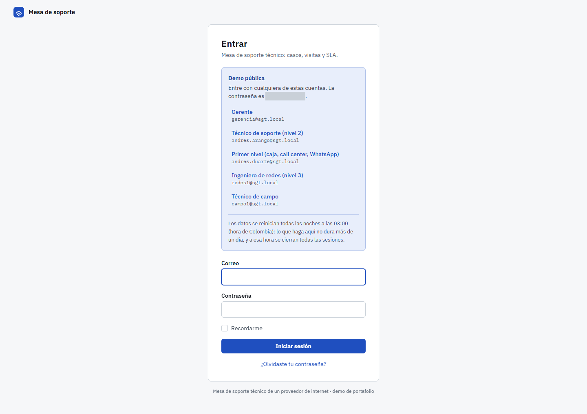

Si se le olvidó la contraseña, use **¿Olvidaste tu contraseña?**, debajo del botón: le llega
un correo con un enlace para crear una nueva. Si el correo no llega o su cuenta está
desactivada, hable con quien administra el sistema; eso no lo puede resolver usted solo.

> **En la demo pública** la caja azul muestra las cuentas de prueba. Al tocar una, el correo
> y la contraseña se llenan solos. Los datos de la demo se borran todas las noches a las
> 03:00 (hora de Colombia) y a esa hora se cierran todas las sesiones.

### El menú

En el computador el menú está a la izquierda. En el celular está escondido: toque el botón
de tres rayas (☰), arriba a la izquierda, para abrirlo.

Cada rol ve solo sus opciones. Si a usted le falta algo que ve un compañero, no es un error:
es que su rol no lo necesita. Al final del menú están su nombre, el enlace a **Perfil** (para
cambiar su nombre, su correo o su contraseña) y **Cerrar sesión**.

### Modo claro y modo oscuro

Al final del menú hay tres botones:

| Botón | Qué hace |
|---|---|
| **Claro** | Fondo claro siempre. |
| **Oscuro** | Fondo oscuro siempre. Descansa la vista en turnos largos o de noche. |
| **Sistema** | Sigue lo que tenga configurado su computador o su celular. Es lo que viene por defecto. |

El cambio se ve al instante y queda guardado en su cuenta: si entra desde otro equipo,
lo encuentra igual.

| Claro | Oscuro |
|---|---|
| 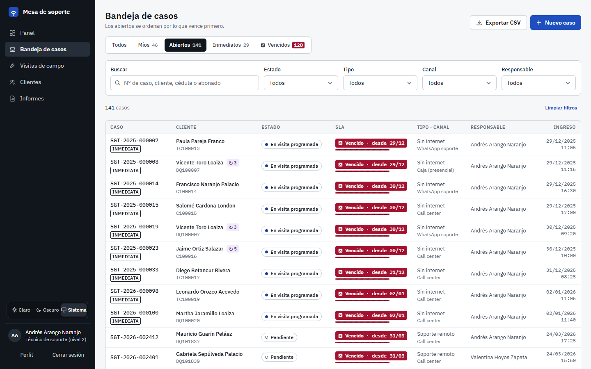 | 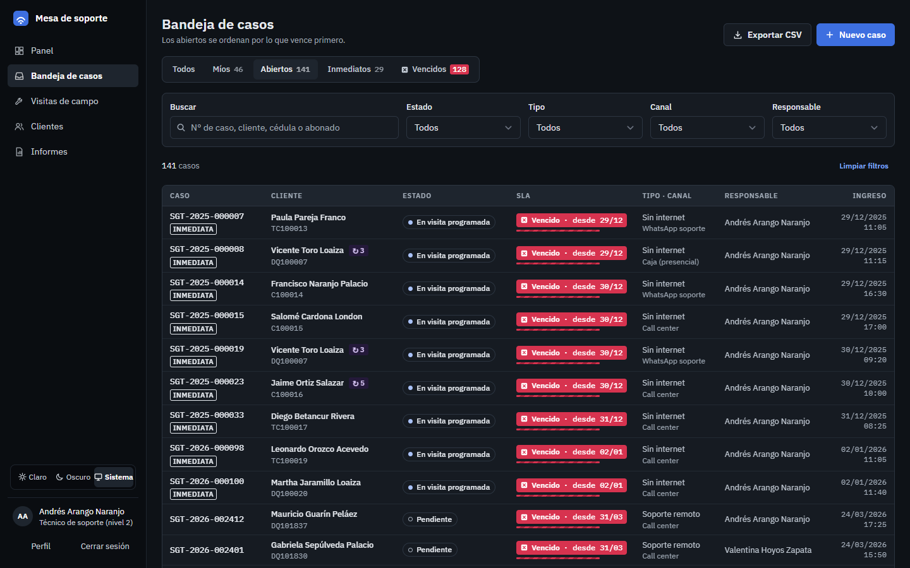 |

Dos excepciones, a propósito:

- **La pantalla de campo** (Mi ruta) tiene su propio botón **Noche / Día** y es clara por
  defecto, porque se usa al sol. Elegir oscuro en el computador no la cambia.
- **Al imprimir**, todo sale en claro, aunque esté usando el modo oscuro.

### Cómo leer el semáforo de SLA

El **SLA** es el tiempo que tiene el caso para resolverse:

- **Inmediato** (el servicio está caído): **4 horas hábiles**.
- **Normal** (todo lo demás): **5 días hábiles**.

El reloj **solo corre en horario hábil**: de lunes a viernes, de 7:00 a. m. a 6:00 p. m., sin
contar los festivos de Colombia. Un caso que entra un viernes a las 5:00 p. m. no pierde el
fin de semana.

Cada caso muestra su semáforo con **cuatro señales a la vez**: una **forma**, una **palabra**,
una **barra** y un **tiempo**. Así se entiende aunque la pantalla esté al sol, se imprima en
blanco y negro o la persona no distinga bien los colores.

| Forma | Palabra | Qué quiere decir | El tiempo que muestra |
|---|---|---|---|
| ● círculo | **En plazo** | Va bien: ha usado menos del 60 % del tiempo. | Lo que le queda |
| ▲ triángulo | **Atención** | Ya usó más del 60 %. Conviene moverlo pronto. | Lo que le queda |
| ◆ rombo con «!» | **En riesgo** | Ya usó más del 85 %. Atiéndalo ya. | Lo que le queda |
| ■ cuadro con ✕ | **Vencido** | Se pasó del tiempo. Es el único que va relleno de color, con la barra a rayas. | Desde cuándo está vencido |
| ❚❚ pausa | **En pausa** | El reloj está detenido porque el caso espera a alguien más. | Por qué está en pausa: *visita*, *redes* o *cliente* |

La **barra** de abajo se va llenando a medida que se gasta el tiempo.

**¿Cuándo se pausa el reloj?** Cuando el caso deja de depender del técnico de soporte:

- cuando se **programa una visita** a terreno (*visita*);
- cuando se **escala a ingeniería de redes** (*redes*);
- cuando se marca que **el cliente no contesta** (*cliente*).

Cuando el caso vuelve, el reloj sigue donde se había quedado. A nadie se le cobra el tiempo
en que no podía hacer nada.

**El estado del caso** va en otra etiqueta, con borde y un punto: *Pendiente*, *En proceso*,
*En seguimiento*, *Sin contacto*, *En visita programada*, *En ingeniería de redes* (con un
rombo), *Solucionado* (con un ✓) y *Cancelado* o *Cerrado sin contacto* (tachados). Esa
etiqueta dice **en qué va** el caso; el semáforo dice **cuánto tiempo le queda**.

Otras dos marcas que va a ver:

- **INMEDIATA**: recuadro negro (o claro, en modo oscuro). El servicio del cliente está
  caído.
- **↻ 3**: el cliente es **recurrente**; el número dice cuántos casos tiene registrados.

---

## Call center (primer nivel)

**Qué puede hacer:** registrar casos, buscar y crear clientes, ver la bandeja y la ficha de
cada caso, asignar el técnico de soporte, elevar un caso a inmediato y cancelar los casos que
usted mismo registró mientras sigan *Pendientes*.

Solo se registra lo que **no se pudo resolver en el momento**. Si usted le resolvió el
problema al cliente en la llamada, en la caja o por WhatsApp, no hay que crear nada.

### Crear un caso

1. En el menú, toque **Bandeja de casos** y luego **Nuevo caso** (arriba a la derecha).
2. **Cliente.** Escriba al menos tres letras o números del nombre, la cédula o el código de
   abonado, y toque el cliente en la lista. Si tiene varios contratos, puede escoger uno
   (es opcional).
   - Si el cliente no aparece, créelo primero en **Clientes → Nuevo cliente** y vuelva.
3. **Solicitud.**
   - **Tipo de solicitud**: sin internet, soporte remoto, cambio de plan o cambio de titular.
     Según el tipo, el formulario le pide cosas distintas.
   - **¿Por dónde entró?**: caja, call center o WhatsApp. Parece un dato menor, pero es el
     que después dice por qué canal llega el trabajo.
   - Para fallas: el **servicio afectado** (internet, TV o los dos) y la **falla reportada**.
   - Para cambio de plan: el plan anterior, el nuevo y cuándo se ejecuta.
   - Para cambio de titular: cédula, nombre y teléfono del nuevo titular, y si incluye
     cambio de plan o traslado.
4. **Detalle.** Escriba lo que dice el cliente, con sus palabras. «Desde anoche no le carga
   nada y el módem tiene una luz roja» le sirve al técnico. «Falla de internet» no le sirve a
   nadie.
5. Toque **Guardar caso**.

**La urgencia no se escoge: la calcula el sistema.** Si el servicio está caído, el caso entra
como **inmediato**; el resto, como **normal**. No hay una casilla de «urgente», y es a
propósito: cuando todo el mundo puede marcar urgente, en dos semanas todo es urgente.

Si de verdad un caso normal debe atenderse ya, ábralo y toque **Elevar a inmediato**. Le pide
el motivo, y queda registrado en el historial.

### Buscar un caso

En **Bandeja de casos** use el buscador (número de caso, nombre, cédula o código de abonado)
o los filtros de estado, tipo, canal y responsable. Arriba hay vistas rápidas: **Todos**,
**Míos**, **Abiertos**, **Inmediatos** y **Vencidos**.

### Clientes

En **Clientes** busca por nombre, cédula o código de abonado. En la ficha del cliente ve sus
datos de contacto, sus contratos con los equipos instalados y sus últimos casos. Con
**Editar** corrige sus datos y con **Nuevo caso** registra un caso para él sin tener que
buscarlo otra vez.

---

## Técnico de soporte (nivel 2)

**Qué puede hacer:** todo lo del call center, y además trabajar los casos: resolverlos,
ponerlos en seguimiento, marcar que el cliente no contesta, programar visitas y escalar a
redes. Puede trabajar los casos que tiene asignados y los que todavía no tienen responsable.

### La bandeja

**Bandeja de casos → Abiertos** le muestra todo lo que está sin cerrar, **ordenado por lo que
vence primero**: lo de arriba es lo más urgente. **Míos** le muestra solo los suyos.

Toque el número del caso (o cualquier parte de la fila) para abrir su ficha.

En el celular la bandeja se ve como tarjetas, con el semáforo arriba:

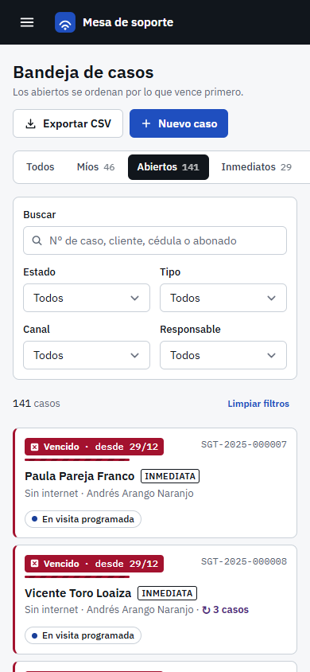

### La ficha del caso

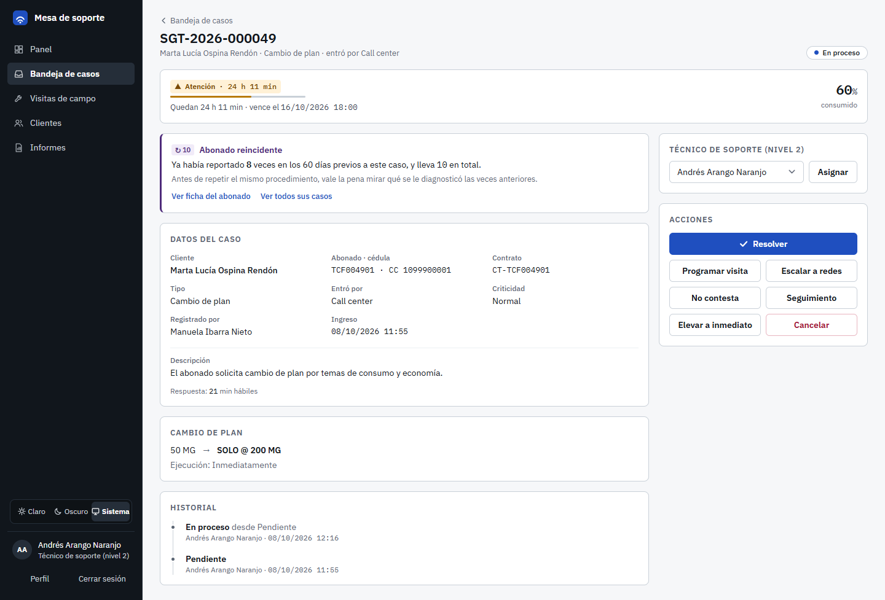

Arriba está el reloj, con el semáforo, la hora en que vence y cuánto tiempo se ha gastado.
Si el cliente ha reportado varias veces, aparece el aviso **Abonado reincidente**: antes de
repetir el mismo procedimiento, mire qué se le diagnosticó las veces anteriores.

A la derecha (en el celular, justo debajo del reloj) están el **responsable** y las
**acciones**. Solo aparecen los botones que se pueden usar en ese momento.

### Asignar un caso

1. En la ficha, en **Técnico de soporte (nivel 2)**, escoja el nombre.
2. Toque **Asignar**.

Si el caso estaba *Pendiente*, pasa a *En proceso*. Si ya tiene una visita en curso, solo un
administrador puede cambiar el responsable.

### Resolver un caso

1. Toque **Resolver**.
2. Escoja el **diagnóstico**: qué era en realidad.
3. Escriba **qué se hizo** (al menos diez letras).
4. Toque **Confirmar cierre**.

El diagnóstico no es un trámite: es el dato que después dice si el barrio tiene un problema
de red o si son veinte módems viejos. Un caso con una visita pendiente no se puede cerrar:
se cierra cuando la visita se hace.

### Cuando el cliente no contesta (reintentos)

1. Toque **No contesta** y confirme.

El sistema cuenta el intento y programa el siguiente para **cuatro horas hábiles después**.
Mientras tanto el reloj se pausa. Usted no tiene que acordarse: cuando llega la hora, el caso
vuelve solo a la bandeja para que lo intente otra vez. Si el cliente devuelve la llamada
antes, toque **Retomar**.

Al **tercer intento sin respuesta**, el caso se cierra como **Cerrado sin contacto**, dejando
constancia de los tres intentos. Así no se queda abandonado.

En la ficha, la línea **Intentos de contacto** dice cuántos van y cuándo es el próximo.

### Poner en seguimiento

Si ya hizo lo que había que hacer y solo falta confirmar con el cliente que quedó bien, toque
**Seguimiento**. El caso sigue abierto y a su nombre.

### Programar una visita

Cuando el problema necesita que alguien vaya a la casa del cliente:

1. Toque **Programar visita**.
2. Escoja el **técnico de campo**, la **fecha** (hoy o un día después) y la **franja**
   (mañana o tarde).
3. Toque **Programar**.

El caso pasa a *En visita programada*, el reloj se pausa con el motivo *visita* y la visita
le aparece al técnico en su ruta. En la ficha aparece **Ver visita #…** para seguirla. Cuando
el técnico la cierra, el caso se resuelve solo; si no se pudo hacer, vuelve a usted y el
reloj sigue.

### Escalar a redes

Cuando el problema es de la red y no se resuelve desde soporte:

1. Toque **Escalar a redes**.
2. Escoja el **ingeniero de redes** que lo recibe.
3. Explique **por qué supera al nivel 2** (al menos diez letras).
4. Toque **Escalar**.

El caso pasa a *En ingeniería de redes*, el reloj se pausa con el motivo *redes* y solo ese
ingeniero (o un administrador) lo puede devolver. Cuando lo devuelve, el caso vuelve a
*En proceso* con la respuesta de redes escrita en la ficha.

### Cancelar un caso

Si el caso no aplica (por ejemplo, era un duplicado), toque **Cancelar**, escriba el motivo y
toque **Confirmar cancelación**. Queda en el historial.

### Su informe del mes

Cuando la coordinación publica su informe mensual, le comparte el enlace. Al abrirlo, el
sistema deja constancia de que usted lo recibió. Vea [El informe mensual](#el-informe-mensual).

---

## Ingeniería de redes (nivel 3)

**Qué puede hacer:** ver la bandeja y las fichas, y responder los casos que le escalaron.

### Responder un caso escalado

1. En **Bandeja de casos**, use el filtro **Estado → En ingeniería de redes** para ver lo
   escalado.
2. Abra el caso. En la ficha verá quién lo escaló, cuándo y por qué.
3. Toque **Responder y devolver al nivel 2**.
4. Escriba qué encontró y qué debe hacer el nivel 2 (al menos diez letras).
5. Toque **Devolver al nivel 2**.

El caso vuelve al técnico de soporte, en *En proceso*, y su reloj se reanuda. Su respuesta
queda en la ficha, en la sección **Ingeniería de redes**.

Si el caso se le escaló a otro ingeniero, usted lo puede ver, pero no responder.

---

## Técnico de campo

**Qué puede hacer:** ver su ruta y sus visitas, y cerrarlas desde el celular, con o sin
señal. Solo ve **sus** visitas.

### Instalar Mi ruta en el celular

Abra la dirección del sistema en el navegador del celular, entre y toque **Mi ruta**. Luego
use la opción **Agregar a pantalla de inicio** (o **Instalar aplicación**) del navegador.
Queda con su propio ícono y se abre a pantalla completa. Además, si se queda sin señal, la
ruta abre igual.

### Su ruta del día

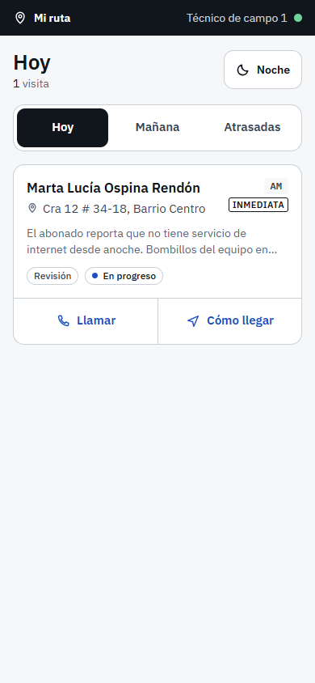

- Tres pestañas: **Hoy**, **Mañana** y **Atrasadas**.
- Cada visita muestra el cliente, la dirección, lo que reportó y la franja (**AM** o **PM**).
  Si dice **INMEDIATA**, el cliente está sin servicio.
- **Llamar** abre el teléfono con el número del cliente. **Cómo llegar** abre el mapa.
- **Noche / Día** cambia la pantalla a oscuro o claro. Se guarda aparte del computador.

La barra de arriba le dice cómo está la conexión:

| Barra | Qué significa |
|---|---|
| Oscura, con su nombre y un punto verde | Hay señal y no hay nada pendiente. |
| Café: **Sin señal · …** | No hay señal. Lo que cierre se guarda en el teléfono. |
| Azul: **Enviando 1 pendiente…** | Volvió la señal y se están mandando los cierres guardados. |

### Cerrar una visita

1. Toque la visita en su ruta. El sistema anota la hora en que la abrió.
2. Escoja el resultado con los botones grandes:

**Si se resolvió:**

1. **¿Qué era?** Escoja el diagnóstico.
2. **¿Qué hiciste?** Describa el trabajo (al menos diez letras).
3. **Material usado** (si usó): escoja el material, la cantidad y toque **+**. Se descuenta
   solo del inventario.
4. **Fotos** (hasta seis): toque **Tomar foto**; se abre la cámara de atrás.
5. **Firma del cliente** (opcional): pásele el teléfono para que firme con el dedo en el
   recuadro blanco. **Borrar** la limpia.
6. Toque **Cerrar la visita**, abajo.

**Si no se pudo:** toque **No se pudo**, explique por qué (por ejemplo, «No había nadie, se
llamó dos veces») y toque **Registrar que no se pudo**. El caso vuelve a soporte y el reloj
se reanuda.

El botón de abajo se activa cuando lo obligatorio está completo.

### Sin señal

**Cierre la visita igual.** Todo (diagnóstico, fotos, firma, material) se guarda en el
teléfono y se manda solo cuando vuelve la señal. No tiene que volver a escribir nada.

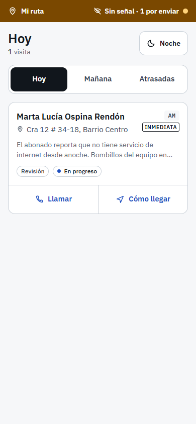

Después de cerrar sin señal, la pantalla dice **Guardado en el teléfono** y vuelve a su ruta.
La barra café le dice cuántos cierres faltan por enviar: **Sin señal · 1 por enviar**.
Cuando vuelve la señal, la barra se pone azul mientras los envía y después vuelve a la
normalidad.

- Puede cerrar la aplicación o apagar la pantalla: lo guardado no se pierde.
- El sistema registra **la hora en que usted cerró la visita**, no la hora en que llegó al
  servidor. Si cerró a las 10:05 sin señal y se envió a las 2:30, la visita terminó a las 10:05.
- Si la barra dice **Tu sesión se cerró**, toque **entra otra vez**: al volver a entrar, lo
  pendiente se envía solo.
- Si el servidor **no aceptó** un cierre (por ejemplo, porque la visita ya la había cerrado
  otra persona), la barra muestra **cierres sin aceptar en este teléfono**. Tóquela: puede
  **Descargar copia** (con fotos y firma) o **Descartar**. No se borra solo, porque la firma y
  las fotos no se pueden volver a tomar.

### Mis visitas

En **Mis visitas** está la lista completa de sus visitas, con su estado. Desde el computador
también puede abrir una visita, anotar material y registrar el resultado.

---

## Gerencia

**Qué puede hacer:** ver y trabajar cualquier caso, ver el panel, los clientes y los
recurrentes, escribir y publicar los informes del mes, manejar el inventario y exportar.

### El panel

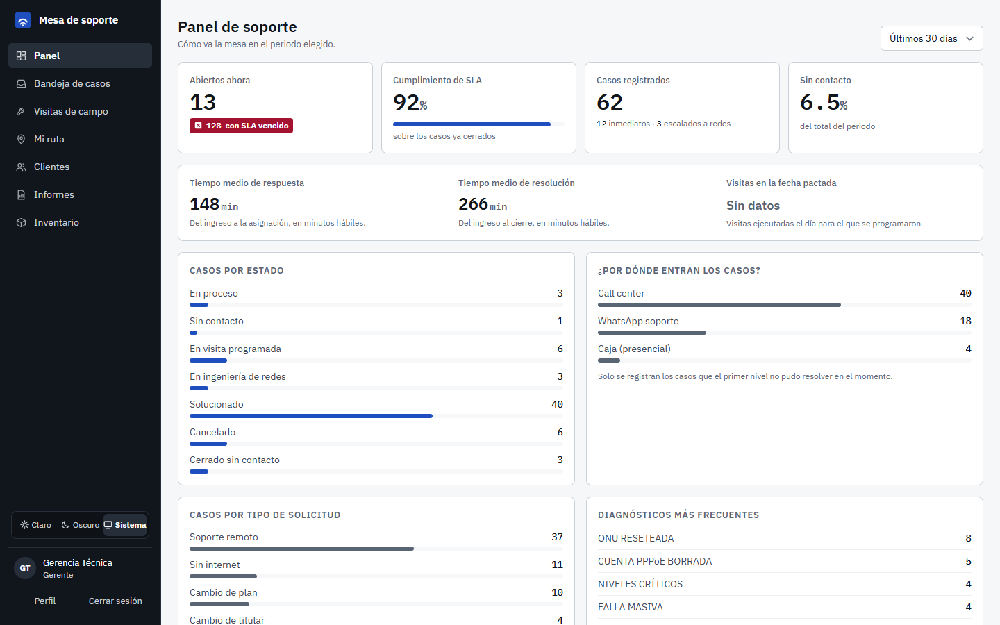

**Panel** muestra cómo va la mesa en el periodo que escoja (arriba a la derecha: 7, 30 o 90
días, o el último año):

- **Abiertos ahora**, con los que tienen el SLA vencido (toque ese aviso rojo para verlos en
  la bandeja);
- **Cumplimiento de SLA**, sobre los casos ya cerrados;
- casos registrados, sin contacto y los tiempos medios de respuesta y de resolución;
- casos por estado, por canal y por tipo, los diagnósticos más frecuentes y la carga por
  técnico.

### Abonados recurrentes

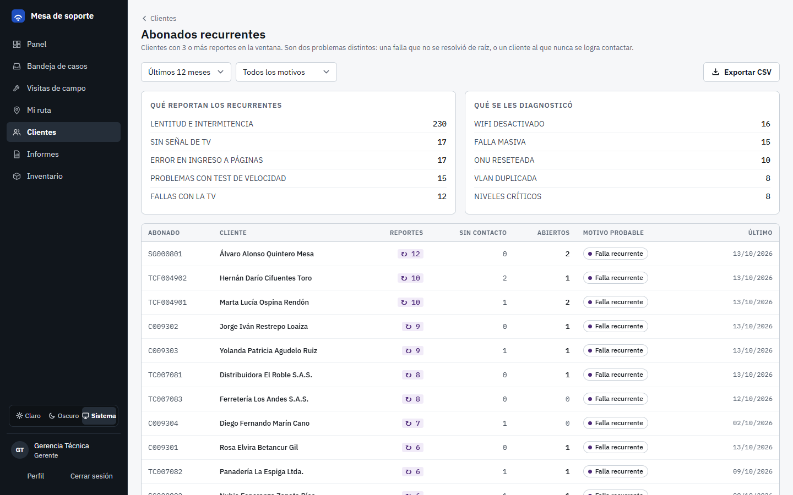

**Clientes → Ver recurrentes** lista a los abonados con tres o más reportes en el periodo
que escoja. Son dos problemas distintos, y el sistema los separa:

- **Falla recurrente**: hay algo de fondo que nadie ha resuelto. Seguir atendiendo síntomas
  no lo arregla: hay que revisar la instalación.
- **No se logra contactar**: el problema no es la red, sino el canal con el cliente. Insistir
  por el mismo medio no funciona: hay que agendar una visita o buscar otro contacto.

Arriba ve qué reportan y qué se les diagnosticó. Toque un cliente para ver su ficha.

### El informe mensual

Una vez al mes se hace un informe por técnico de soporte, con las cifras del mes y un
espacio para la retroalimentación.

1. En el menú, toque **Informes** y escoja el **mes** y el **año**.
2. En la fila del técnico, toque **Generar** (o **Abrir**, si ya existe).
3. Revise las cifras: casos resueltos, sin contacto, escalados, visitas, casos por día,
   fallas, diagnósticos y cómo se compara con el promedio del equipo.
4. Escriba las **observaciones** y los **compromisos para el próximo mes**.
5. Toque **Guardar borrador** si lo va a terminar después.
6. Cuando esté listo, toque **Publicar**.

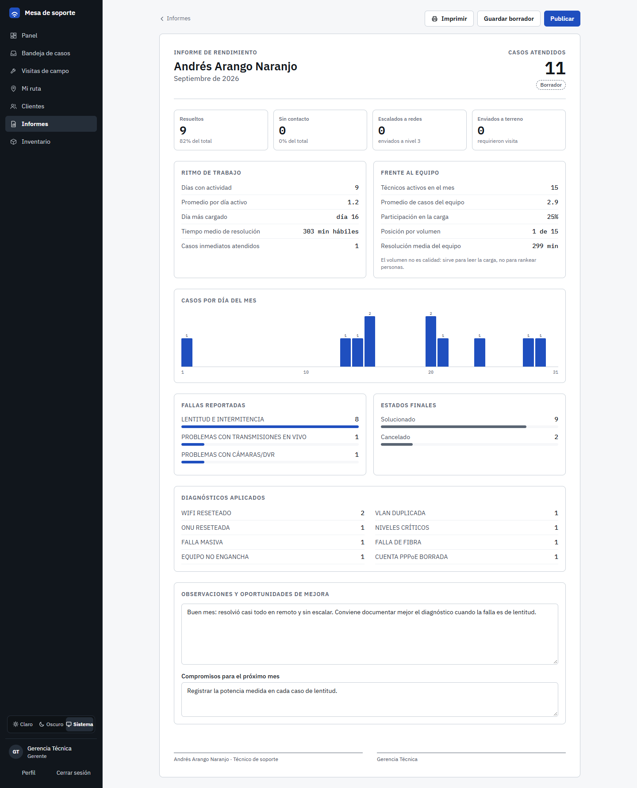

**Al publicar, las cifras se congelan** y el informe ya no se puede editar: un documento
firmado no debe cambiar porque después alguien movió un caso viejo. Comparta el enlace con el
técnico; cuando él lo abra, el informe mostrará **Recibido por el técnico** con la fecha.

**Imprimir** lo saca en papel, siempre en claro y sin el menú, con las dos líneas para firmar.

### Inventario

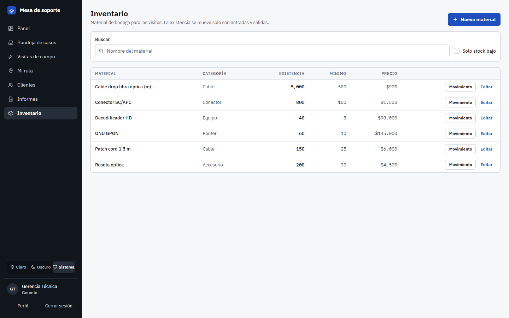

**Inventario** es el material de bodega para las visitas.

- **Nuevo material**: nombre, categoría, stock mínimo y precio.
- **Movimiento**: registra una **entrada** (compra o devolución a bodega) o una **salida**
  (baja o pérdida) con su cantidad. La existencia no se edita a mano: solo cambia con
  movimientos, para que las cuentas siempre cuadren.
- **Editar**: cambia nombre, categoría, mínimo o precio.
- Toque el nombre del material para ver su **kardex**: cada entrada, salida y consumo, con la
  fecha, el técnico y la visita.

Cuando un técnico registra material en una visita, se descuenta solo. Si algún material está
en el mínimo o por debajo, arriba aparece un aviso con **Ver solo esos**.

### Exportar

La **bandeja de casos** y la lista de **recurrentes** tienen **Exportar CSV**. Sale
exactamente lo que está viendo, con los filtros puestos, y se abre en Excel con las tildes
bien.

### Avisos por correo

Sin que nadie tenga que estar mirando la pantalla, el sistema avisa por correo:

- al **técnico asignado**, cuando su caso entra **en riesgo** (85 % del tiempo);
- a **gerencia y administración**, cuando un caso **se vence** o cuando lleva rato en riesgo
  y **nadie lo ha tomado**.

Llega **un solo correo por persona**, con todos sus casos, y como máximo **dos avisos por
caso**. Fuera del horario hábil no se avisa, porque el reloj está detenido.

---

## Administración

**Qué puede hacer:** todo lo de gerencia, y además administrar los usuarios, cambiar el
responsable de un caso con visita en curso y responder casos escalados a redes.

### Gestión de usuarios

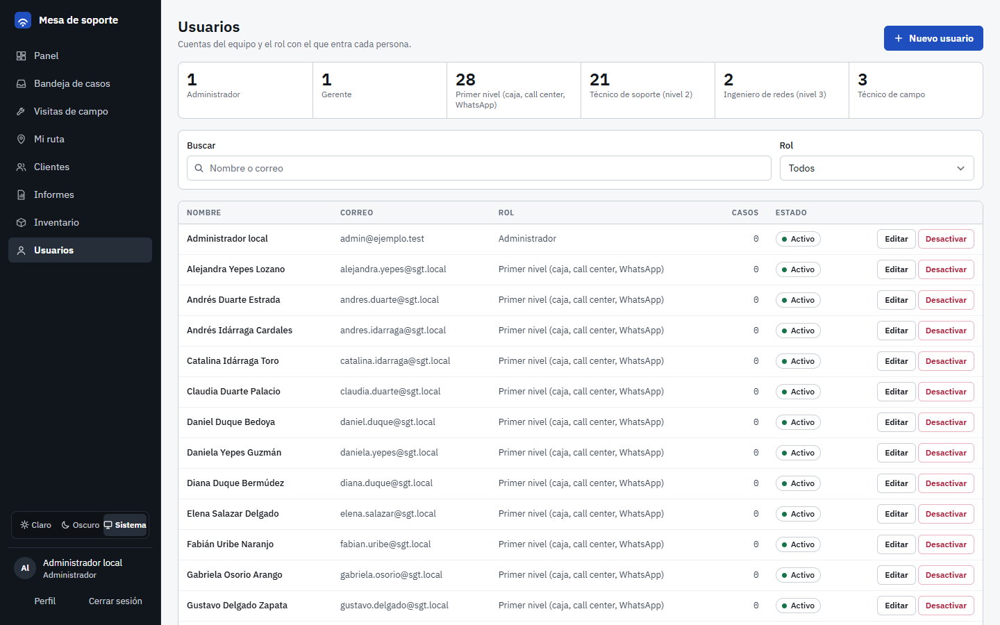

En **Usuarios** ve cuántas personas hay en cada rol y la lista completa. Puede buscar por
nombre o correo y filtrar por rol.

**Crear un usuario:**

1. Toque **Nuevo usuario**.
2. Escriba el **nombre completo** y el **correo**.
3. Escoja el **rol**. Debajo aparece qué puede hacer ese rol.
4. Si es **técnico de campo**, escriba su **teléfono**: con eso se le crea el perfil para
   asignarle visitas.
5. Escriba la **contraseña** dos veces.
6. Toque **Crear usuario**.

**Cambiar un usuario:** toque **Editar**. Si deja la contraseña en blanco, no se cambia.

**Cuando alguien se va:** toque **Desactivar**. Los usuarios **no se borran**, se
desactivan: así los casos viejos siguen diciendo quién los atendió. Con **Activar** vuelve a
entrar.

En la demo pública, las cuentas de prueba están protegidas: no se les puede cambiar el
nombre, el correo ni la contraseña, ni se pueden borrar.

---

## Preguntas frecuentes

**Cerré una visita sin señal, ¿se perdió?**
No. Quedó guardada en el teléfono y se envía sola cuando vuelve la señal; la barra de arriba
le dice cuántos cierres faltan por enviar. No borre los datos del navegador ni desinstale la
aplicación mientras haya cierres pendientes. Si la barra dice que la sesión se cerró, vuelva a
entrar y se envían solos.

**Apagué el teléfono antes de que volviera la señal.**
No pasa nada. Al abrir otra vez la aplicación con señal, lo pendiente se envía.

**Un cierre aparece como «sin aceptar».**
El servidor lo rechazó, casi siempre porque esa visita ya estaba cerrada. Toque la barra
para verlo. Puede descargar una copia (con fotos y firma) antes de descartarlo y, si hace
falta, avisarle a soporte.

**No me deja cerrar un caso que mandé a terreno.**
Es a propósito: ese caso se cierra cuando la visita se hace. Si la visita ya no hace falta,
el técnico de campo la registra como «No se pudo» y el caso vuelve a usted.

**Se me venció un caso y no era mi culpa.**
El reloj se pausa mientras el caso espera una visita, a redes o al cliente. Si aun así se
venció, el historial de la ficha muestra cada paso con su hora: eso es justamente lo que el
informe del mes sirve para conversar.

**¿Por qué no puedo marcar un caso como urgente al crearlo?**
La urgencia la calcula el sistema: si el servicio está caído, es inmediato. Si un caso normal
de verdad no puede esperar, ábralo y use **Elevar a inmediato**, con el motivo.

**El cliente llamó otra vez por lo mismo.**
Regístrelo como un caso nuevo. El sistema lo detecta solo: la ficha muestra el aviso de
abonado reincidente y el cliente aparece en la lista de recurrentes.

**Cerré un caso por error.**
Un caso cerrado no se reabre desde la pantalla. Registre un caso nuevo y mencione el número
del anterior en la descripción.

**Al imprimir sale en claro aunque uso el modo oscuro.**
Es a propósito: en papel, el fondo oscuro gasta tinta y se lee mal.

**No veo una opción que sí ve un compañero.**
El menú depende del rol. Si cree que su rol no es el correcto, pídale a un administrador que
lo revise.

**Olvidé mi contraseña.**
Use **¿Olvidaste tu contraseña?** en la pantalla de entrada. Si no le llega el correo, hable
con un administrador.

**Las cifras de un informe publicado no coinciden con el panel.**
Es normal: al publicar, el informe congela sus cifras. El panel siempre muestra lo de hoy.

---

## Resumen: qué puede hacer cada rol

| | Call center | Técnico de soporte | Redes | Técnico de campo | Gerencia | Admin |
|---|:-:|:-:|:-:|:-:|:-:|:-:|
| Ver la bandeja y las fichas | ✓ | ✓ | ✓ | | ✓ | ✓ |
| Crear casos y clientes | ✓ | casos | | | ✓ | ✓ |
| Asignar el técnico de soporte | ✓ | ✓ | | | ✓ | ✓ |
| Resolver, no contesta, seguimiento, visita, escalar | | ✓ ¹ | | | ✓ | ✓ |
| Elevar a inmediato | ✓ | ✓ ¹ | | | ✓ | ✓ |
| Cancelar | sus casos pendientes | ✓ ¹ | | | ✓ | ✓ |
| Responder un caso escalado | | | el suyo | | | ✓ |
| Mi ruta y cerrar visitas en el celular | | | | sus visitas | ✓ | ✓ |
| Panel | ✓ | ✓ | ✓ | ✓ | ✓ | ✓ |
| Recurrentes y exportar CSV | ✓ | ✓ | ✓ | | ✓ | ✓ |
| Informes del mes | | el suyo ² | | | ✓ | ✓ |
| Inventario | | | | | ✓ | ✓ |
| Usuarios | | | | | | ✓ |

¹ En los casos que tiene asignados o que todavía no tienen responsable.
² Lo lee con el enlace que le comparte la coordinación.
